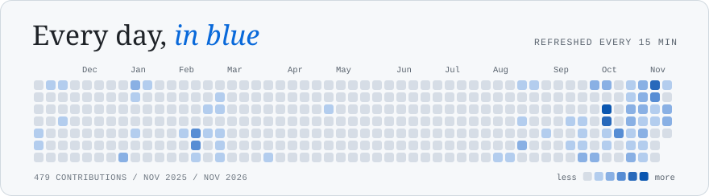
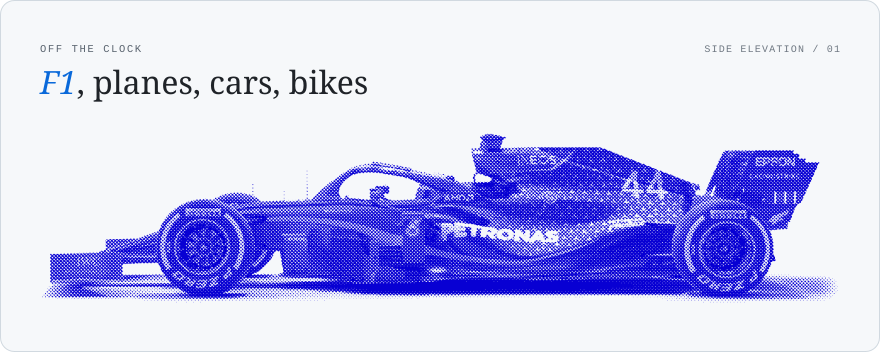

<picture>
  <source media="(max-width: 600px)" srcset="assets/name-banner-mobile.svg">
  
</picture>

  Redrawn nightly from public activity with <a href="https://github.com/yalongwastaken/git-koi">git-koi</a>
   
  

I build agentic systems, embedded hardware and the web, usually where those three meet.

Most of the work is verification: calibrated thresholds, deterministic gates, evidence trails. A system should be able to explain why it said yes.

## Selected work

- **[Zen MCP](https://github.com/spaxe-dev/zen-mcp)**: an MCP server that lets an agent work inside Zen Browser, with native spaces, background research tabs, in-browser questions, and an evidence mode that reopens the source it cites. TypeScript, 53 tools, on [npm](https://www.npmjs.com/package/@spaxe-dev/zen-mcp).
- **[SatQuery](https://github.com/spaxe-dev/satquery)**: a local-first remote-sensing assistant that validates inputs, routes specialist tools, fuses optical and SAR evidence, and returns the reasoning trace behind its answer. Python, FastAPI.
- **[ZipCheck](https://github.com/spaxe-dev/zipcheck)**: a static archive-bomb detector that reads metadata, follows nested archives, and verifies real output without writing extracted files. Python, on [PyPI](https://pypi.org/project/zipcheck/).
- **[Tremor Pro](https://github.com/spaxe-dev/Tremor-Pro)**: ESP32 and MPU6050 motion capture with band-power features, a random-forest classifier, and a local session dashboard. C++, FastAPI.

Also: [Ethanol Blend Analyzer](https://github.com/spaxe-dev/ethanol-blend-analyzer) for calibrated fuel sensing on an ESP32, and [AIRI](https://github.com/spaxe-dev/airi-security-agent), an autonomous security agent built for AIJC 2026.

## Open source

- **[HatchZip](https://github.com/xevrion/hatchzip)** (Rust): merged [#23](https://github.com/xevrion/hatchzip/pull/23) and [#37](https://github.com/xevrion/hatchzip/pull/37), with [#100](https://github.com/xevrion/hatchzip/pull/100) open. #37 verifies extracted files before truncating, so a file removed mid-run no longer disappears silently.
- **[OpenCode](https://github.com/anomalyco/opencode)** (TypeScript): open [#60178](https://github.com/anomalyco/opencode/pull/60178), a keyboard-driven path picker for the last response in the TUI.

## Stack

- **Embedded systems:** C, C++, ESP32, STM32, Linux, UART, SPI, I²C, RTOS
- **Machine learning:** Python, PyTorch, OpenCV, Transformers, FAISS, model evaluation
- **Software:** TypeScript, React, Next.js, React Native, FastAPI, Docker, PostgreSQL, Git

The tools that show up in the work, not everything I have tried.

<picture>
  <source media="(max-width: 600px)" srcset="assets/heatmap-light-mobile.svg">
  
</picture>

<picture>
  <source media="(max-width: 600px)" srcset="assets/off-the-clock-mobile.svg">
  
</picture>

---

[aadit.tech](https://aadit.tech) · [GitHub](https://github.com/spaxe-dev)

Open to internships and freelance work.
